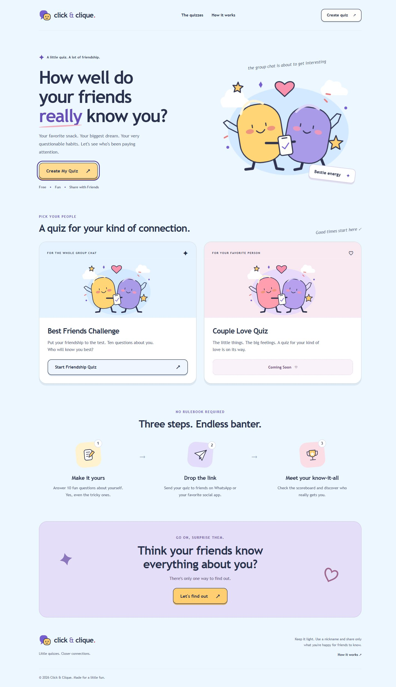
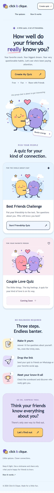

# Phase 2 — homepage implementation

Status: **PASS for the Phase 2 homepage scope**, ready for independent review. This is not a production-security approval or a deployment report.

## Scope and foundation dependency

Branch: `feature/phase-2-homepage`, based on published `main` at `63747f77b3e349793b1048e397c4e812c55830dd`.

Security PR [#1](https://github.com/advertisingbwp-cmyk/Couple-Quiz/pull/1), head `583217f2d2690607c2a29784d2688143d38af0b3`, was still open and unmerged when this work began. It was not modified, merged, or included in this branch. No Phase 1.4 remote branch was present at inspection. Foundation review remains a separate release dependency: the known issues fixed in PR #1 remain on this branch's main baseline. Do not interpret the existing five foundation tests passing as proof of real Redis correctness; their mock-path weakness is addressed separately by PR #1.

Only `/quiz` and its new homepage components, artwork, test wiring, and review evidence changed. API routes, Redis, storage, encryption, PIN authentication, and all five existing quiz-flow pages remain unchanged. No Phase 3 or image-based MCQs were started.

## Delivered design

- Original **Click & Clique** wordmark, speech-bubble icon, and SVG character artwork. The reference was inspected for visual direction; no reference graphics were downloaded or copied.
- Hero with a real Create My Quiz action and Free / Fun / Share with Friends support text.
- Best Friends Challenge with a working setup action; Couple Love Quiz explicitly marked **Coming Soon**, without a pretend launch button.
- Three-step explanation, engagement banner, responsive navigation and footer with functional section links and a dynamic year.
- Setup uses a native modal dialog with accessible labels, focused nickname input, keyboard tab loop, Escape dismissal, focus restoration and native radio keys. A trimmed nickname and wording selection use the existing creator session contract before navigating to `/quiz/create`.
- Blank/oversized names and blocked session storage are handled. No quiz is submitted by the homepage.
- Local system typography, no external font/image requests, responsive SVGs, scoped styles, finite entrance animations and a reduced-motion override. No zoom restrictions.

Reusable components: `Navbar`, `HeroSection`, `CategoryCard`, `HowItWorks`, `CTASection`, `Footer`, shared `StartButton`/`Brand`, plus `BrandMark`, `FriendsArt`, `StepIcon`.

Palette: sky `#edf7ff`, ink `#29324c`, purple `#6650b7`, yellow `#ffce71`, pink `#f993ad`, coral `#e77b7d`, white cards. Soft offset shadows and rounded corners supply the cartoon styling. Calculated text contrast samples: ink/sky 11.69:1; body/white 6.33:1; purple/sky 5.70:1; Coming Soon text/background 5.66:1; muted text/sky 5.54:1; button text/yellow 8.65:1; banner eyebrow/background 5.45:1. This is palette verification, not a full automated accessibility certification.

## Execution evidence — 2026-10-14

| Check | Actual result |
| --- | --- |
| `npm run typecheck` | Exit 0 |
| `npm run lint` | Exit 0, no ESLint warnings/errors |
| `npm test` | Exit 0, 8 passed, 0 failed, 0 skipped |
| `npm run build` | Exit 0, all existing routes generated; `/quiz` 5.19 kB / 106 kB first-load JS |
| Production preview | `next start` on localhost:3013, actual browser checks |
| CTA navigation | Setup submit opened `/quiz/create` with Question 1 of 10; checked in development and production |
| Entry points | Header, hero, friendship card and banner all opened setup |
| Setup validation | Empty submission displayed alert and focused the name field |
| Keyboard | Shift+Tab and Tab wrapped within dialog; visible solid focus outline; arrow key selected Female; Escape closed and restored Create My Quiz focus |
| Section navigation | Quiz and How It Works links reached their actual section anchors |
| Browser errors | No production browser console errors observed |

Three new regression cases cover both wording choices and trimmed-name handoff, empty/oversized input without writes, and failure on either session-storage write. The five pre-existing tests also ran unchanged. Browser checks were executed interactively, not installed as an automated browser suite. No real Redis integration test was run in this UI-only branch.

All six required widths were measured and full-page captures visually inspected:

| Viewport width | Content width / scroll width | Overflowing elements | Minimum main CTA/header button height |
| --- | --- | --- | --- |
| 320 | 305 / 305 | 0 | 44 px |
| 375 | 360 / 360 | 0 | 44 px |
| 430 | 415 / 415 | 0 | 44 px |
| 768 | 753 / 753 | 0 | 46 px |
| 1024 | 1009 / 1009 | 0 | 46 px |
| 1440 | 1425 / 1425 | 0 | 46 px |

The 15 px difference is the desktop browser's vertical scrollbar. No horizontal scrolling, overlapping content or distorted artwork was observed. Viewport meta is `width=device-width, initial-scale=1`. Reduced-motion support was verified in source; operating-system preference emulation was not performed. No physical-device, Firefox, Safari, screen-reader or full 200% browser-zoom test is claimed.

[Raw responsive measurements](phase-2-screenshots/responsive-results.json)

## Changed files

- `app/quiz/page.tsx`: homepage composition and original homepage metadata/icon.
- `components/quiz-home/Homepage.tsx`: reusable sections and accessible setup flow.
- `components/quiz-home/Illustrations.tsx`: original decorative SVG artwork.
- `components/quiz-home/homepage.module.css`: isolated responsive styles and motion rules.
- `components/quiz-home/creatorSetup.ts`: existing creator-session contract and error handling.
- `public/quiz/clique-mark.svg`: original homepage favicon.
- `tests/homepage.test.ts`: three regression tests.
- `package.json`: include homepage tests in the normal test command; no dependency changes.
- `docs/phase-2-homepage.md` and `docs/phase-2-screenshots/*`: review report, two screenshots and responsive measurements.

## Remaining limitations and review notes

No known homepage defects remain from the checks above. Couple questions remain intentionally unavailable. Existing creator/play/share/result/scoreboard pages retain their old branding and layout until their later UI phase. Existing child-route metadata still emits the baseline `metadataBase` build warning; homepage metadata no longer inherits the reference logo or old site's OpenGraph identity. A dedicated raster social-share image is not supplied in this phase.

PR #1's security changes still require independent review and integration before treating the product as release-ready. Both branches touch the test script: when integrating later, preserve PR #1's test setup/wildcard script so the new `homepage.test.ts` and foundation suites both execute. No merge or production deployment was performed. Stop after Phase 2 and await independent ChatGPT review.
